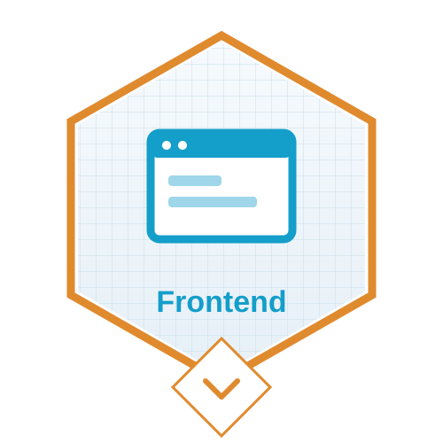
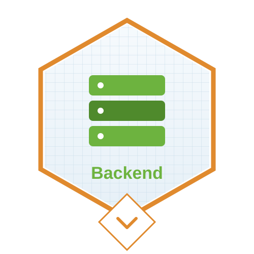
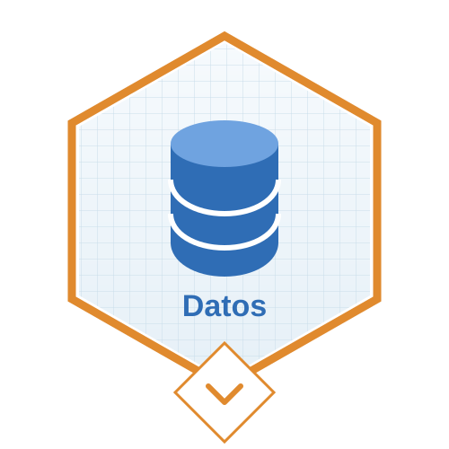
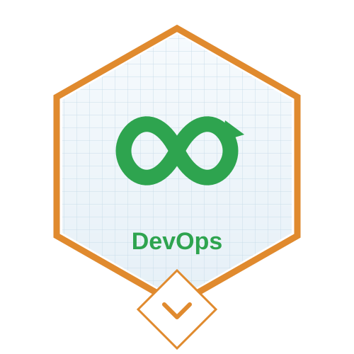
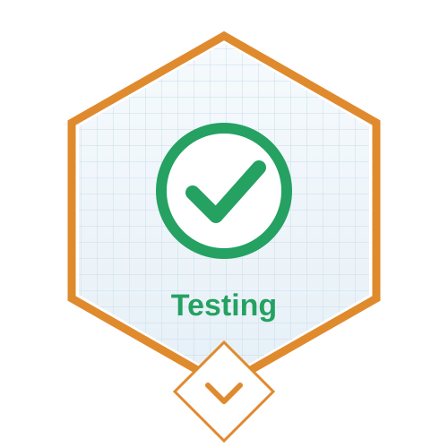
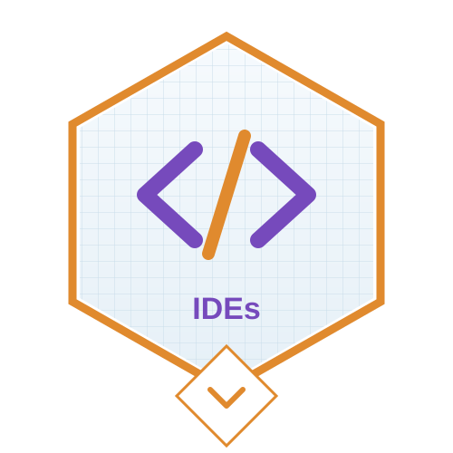
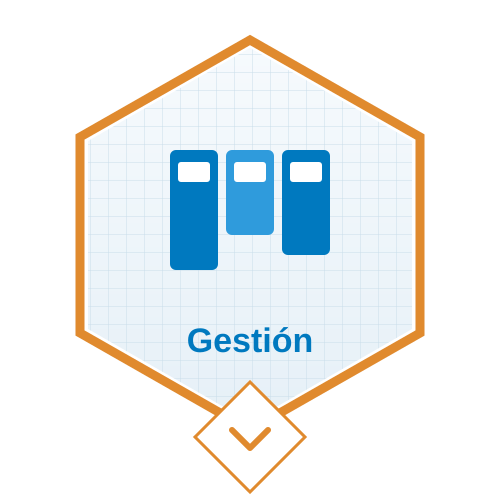
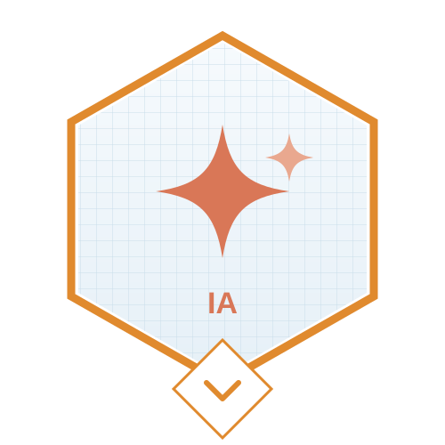

- 👋 Hi, I’m @andresGitDev
- 👀 I’m software development (Frontend-React and Backend-Java)
- 🌱 I am always learning new technologies.
- 💞️ I seek to grow and help grow in business systems projects.
- 📫 How to contact me...

 

  
  
    
        
  
    
  
  

 

  
  

###

### 🏅 Insignias y 🛠️ herramientas

  
  
  
  
  
  
  
  
  

👉 **[Ver portfolio interactivo](https://andresgitdev.github.io/andresGitDev/)**: pasá el cursor por cada categoría para ver todas mis insignias y herramientas, o buscá por nombre.

###

<!---
andresGitDev/andresGitDev is a ✨ special ✨ repository because its `README.md` (this file) appears on your GitHub profile.
You can click the Preview link to take a look at your changes.
--->
